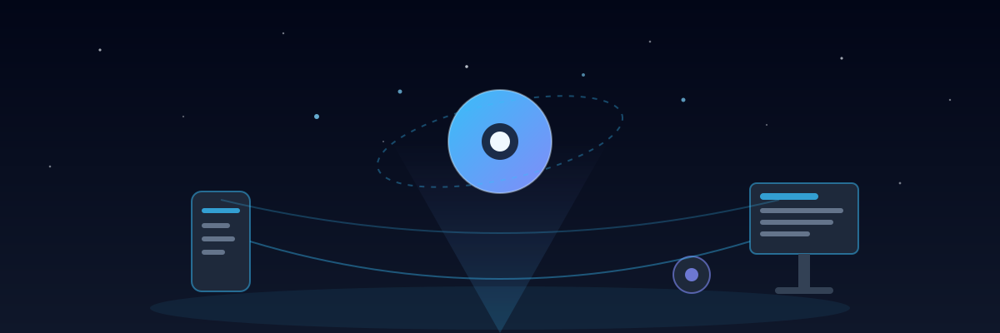

<div align="center">

<a href="docs/README.md"></a>

### ✦ Assisted Personal Intelligence

**Your mind, *externally* upgraded.**

ASI is a self-hosted AI companion for your Mac, Windows PC, iPhone, and Android — **one private brain on your own hardware**, remembering what matters, anticipating what you need, and quietly running your day.

[]()
[]()
[]()
[]()

</div>

---

## ⚡ What is ASI?

ASI (Assisted Personal Intelligence) is not another chatbot. It's a **persistent, context-aware presence** running on *your* hardware — one private brain that every device connects to:

- 🧠 **Remembers** — your routines, preferences, goals, and commitments
- 🔮 **Anticipates** — briefings, prep nudges, and follow-ups, surfaced before you ask
- 🎙️ **Speaks** — voice-first when you want it, text when you don't
- ✍️ **Acts with you** — drafts, schedules, and organizes (always with your approval)
- 💻 **Works everywhere** — coding, teaching, office work, research, social, life admin

One assistant. Every device. Zero context-switching.

## 🏗️ How it works

```
  iPhone · Android · Mac · Windows · Web
              │  all thin clients
              ▼
      ┌───────────────┐
      │  ASI Core     │   runs on YOUR machine
      │  ~/.asi/      │   memory · tasks · schedules · AI
      └───────────────┘
```

- **Self-hosted** — your data lives on your hardware, not a vendor's cloud
- **Single brain** — every device reads/writes the same instance. No sync conflicts.
- **Pluggable AI** — bring your own API keys or run local models
- **Private by default** — no accounts, no telemetry, no open ports

## 📱 Platforms

| Platform | Status |
|----------|--------|
| 💻 macOS (server + app) | Planned — Phase 1 |
| 🪟 Windows | Planned |
| 📱 iOS | Planned — Phase 4 |
| 🤖 Android | Planned — Phase 4 |
| 🌐 Web | Planned — Phase 1 |

## 🗺️ Documentation

Full docs index: **[`docs/README.md`](docs/README.md)**

| Doc | What's inside |
|-----|---------------|
| [Vision](docs/VISION.md) | Why ASI exists, principles, what success looks like |
| [PRD](docs/PRD.md) | Product requirements: personas, use-case domains, user stories, metrics |
| [Roadmap](docs/ROADMAP.md) | 4-phase plan with milestones, gates, and risks |
| [Features](docs/FEATURES.md) | Feature catalog with P0/P1/P2 priorities |
| [Architecture](docs/ARCHITECTURE.md) | System design, data model, API surface, security |
| [Design](docs/DESIGN.md) | Brand personality, UX principles, screens |
| [Getting Started](docs/GETTING_STARTED.md) | Repo layout, contributing, doc map |

## 🛣️ Roadmap at a glance

```
Phase 1          Phase 2           Phase 3            Phase 4
Core Assistant → Personal Context → Proactive AI   → Everywhere
(server + chat   (memory, cal,     (briefings,      (native apps,
 + voice+tasks)   email, goals)     insights,         wake-word,
                                  automation)        plugins)
```

## 🚀 Status

**Coming soon** — we're designing the foundation. Follow the repo for updates.

---

<sub>Built with intent. Your data stays yours. 🛡️</sub>
